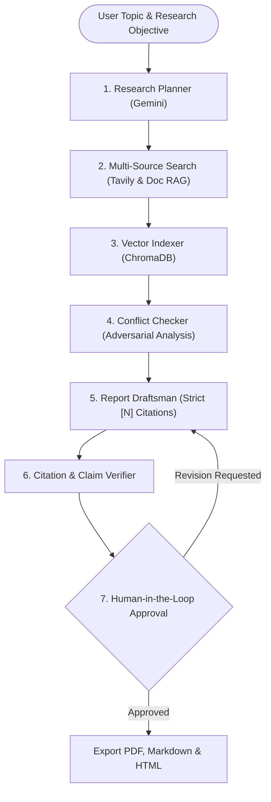

# 🔬 ResearchPilot — Agentic Research Assistant

[](https://www.python.org/)
[](https://langchain-ai.github.io/langgraph/)
[](https://aistudio.google.com/)
[](https://www.trychroma.com/)
[](https://tavily.com/)
[](https://streamlit.io/)
[](LICENSE)

**ResearchPilot** is an enterprise-grade agentic research system that autonomously investigates complex technical, scientific, and market topics. Built with **LangGraph**, **Google Gemini**, **ChromaDB**, **Tavily**, and **Streamlit**, ResearchPilot plans multi-step search strategies, extracts empirical evidence from web searches and uploaded PDF briefings, detects cross-source contradictory claims, audits citations, and enforces strict **Human-in-the-Loop** verification before report export.

---

## 🌟 Key Capabilities & Highlights

| Capability | Technical Implementation | Purpose |
| :--- | :--- | :--- |
| **Multi-Step Agentic Planning** | LangGraph + Gemini Pydantic Output | Deconstructs user queries into targeted sub-questions, rationale, and search queries. |
| **Hybrid Source Retrieval** | Tavily Search + DuckDuckGo + PyPDF | Combines real-time web intelligence with uploaded internal PDF/Markdown briefings. |
| **Vector Indexing & RAG** | ChromaDB + Dense Embeddings | Ingests all retrieved passages with assigned deterministic citation IDs `[1]`, `[2]`. |
| **Conflicting Claims Detection** | Adversarial Evidence Analysis | Cross-examines sources to flag discrepancies in dates, metrics, and trade-offs. |
| **Citation Verification Audit** | Automated Fact-Checking Engine | Validates every assertion against vector evidence, flagging unsupported statements. |
| **Human-in-the-Loop Gate** | Interactive Approval Workflow | Requires human lead sign-off and allows direct markdown editing prior to export. |
| **Multi-Format Export** | ReportLab PDF + Markdown + HTML | Produces audit-stamped research packages with citation matrices and bibliographies. |

---

## 🏗️ Architecture & Agent Workflow

The system is orchestrated as a state machine using **LangGraph**:



### State Machine Lifecycle
1. **Planner Node**: Formulates scientific hypothesis, identifies key dimensions, and produces 3–5 targeted search queries.
2. **Searcher Node**: Queries Tavily Search API, DuckDuckGo, and ingests uploaded research PDFs.
3. **Indexer Node**: Embeds documents into ChromaDB and retrieves semantic chunks for each research angle.
4. **Conflict Checker Node**: Scans evidence for contradictory timelines, cost discrepancies, or opposing conclusions.
5. **Draftsman Node**: Synthesizes evidence into a cited Markdown research report with strict `[N]` bracket citations.
6. **Verifier Node**: Evaluates every claim against vector database evidence and generates a `CitationAuditReport`.
7. **Human Approval Gateway**: Enables the human researcher to inspect flagged claims, edit the draft, and approve export.

---

## 📁 Repository Structure

```text
research-pilot/
├── app.py                     # Streamlit Executive Dashboard
├── run_cli.py                 # Command-line Research Pilot runner
├── run_app.py                 # Application launcher
├── requirements.txt           # Production dependencies
├── .env.example               # Environment variables template
├── src/
│   ├── __init__.py
│   ├── config.py              # Configuration & settings management
│   ├── schemas/               # Pydantic v2 structured data models
│   │   ├── plan.py            # ResearchPlan & SubTopicQuery
│   │   ├── source.py          # SearchResultItem & EvidenceChunk
│   │   ├── conflict.py        # ConflictingClaim & ConflictReport
│   │   ├── verification.py    # VerificationItem, CitationAuditReport, FinalResearchReport
│   │   └── state.py           # LangGraph State TypedDict
│   ├── tools/                 # Retrieval and storage tools
│   │   ├── web_search.py      # Tavily & DuckDuckGo search tool
│   │   ├── doc_loader.py      # Multi-format document parser & chunker (PDF, TXT, MD)
│   │   └── vector_store.py    # ChromaDB persistent & in-memory manager
│   ├── agent/                 # LangGraph Agent Nodes
│   │   ├── graph.py           # StateGraph builder and workflow runner
│   │   ├── planner.py         # Research planning node
│   │   ├── searcher.py        # Search and document retrieval node
│   │   ├── indexer.py         # ChromaDB indexing and vector extraction node
│   │   ├── conflict_checker.py# Contradiction and discrepancy detection node
│   │   ├── draftsman.py       # Citing research author node
│   │   └── verifier.py        # Fact verification & unsupported claim flagging node
│   ├── export/                # Document exporters
│   │   ├── markdown_export.py # Markdown bundle and printable HTML generator
│   │   └── pdf_export.py      # ReportLab executive PDF generator
│   └── ui/                    # Streamlit UI components & styling
│       ├── components.py      # Stepper, scorecards, conflict cards, audit expanders
│       └── styles.py          # Custom CSS theme
└── tests/                     # Unit and integration test suite
    ├── test_schemas.py        # Pydantic schema validation tests
    ├── test_vector_store.py   # ChromaDB indexing and similarity search tests
    └── test_graph_flow.py     # End-to-end LangGraph agent workflow tests
```

---

## ⚡ Quickstart & Installation

### 1. Prerequisites
- Python 3.11 or higher
- Git

### 2. Clone the Repository
```bash
git clone https://github.com/khsl07/research-pilot.git
cd research-pilot
```

### 3. Set Up Virtual Environment
```bash
python -m venv venv
# On Windows:
.\venv\Scripts\activate
# On macOS/Linux:
source venv/bin/activate
```

### 4. Install Dependencies
```bash
pip install -r requirements.txt
```

### 5. Configure API Keys
Copy `.env.example` to `.env`:
```bash
cp .env.example .env
```
Add your credentials:
```env
GEMINI_API_KEY=your_gemini_api_key_here
TAVILY_API_KEY=your_tavily_api_key_here
RESEARCH_MODEL=gemini-2.5-flash
```
*(Note: If API keys are omitted, ResearchPilot seamlessly runs in deterministic demo mode with DuckDuckGo and curated academic briefs!)*

---

## 🚀 Running the Application

### Option A: Streamlit Interactive Web App (Recommended)
```bash
streamlit run app.py
```
Or use the launcher:
```bash
python run_app.py
```
Open your browser to `http://localhost:8501`.

### Option B: Command-Line Interface (CLI)
Run the agent directly in your terminal with interactive human approval:
```bash
python run_cli.py --topic "Commercial Viability of Solid-State Batteries in EVs by 2030"
```

---

## 🧪 Running Automated Tests

Run the complete test suite:
```bash
python -m unittest discover -s tests
```

---

## 🛡️ License

This project is licensed under the MIT License — see the [LICENSE](LICENSE) file for details.
